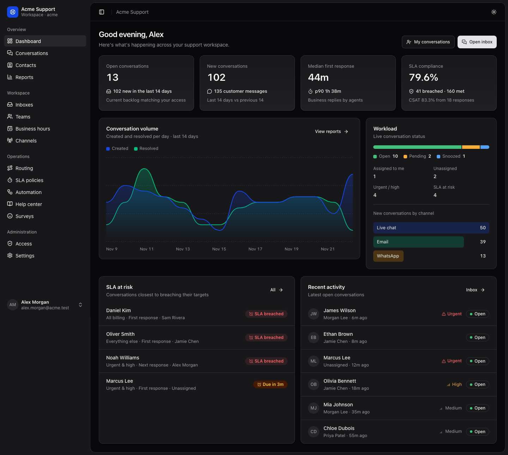

# Blazor management UI

`TicketFlow.UI.Blazor` is an optional Razor Class Library that turns a host ASP.NET Core app into a complete support console: a
shadcn-style dashboard (dark by default, themeable) for conversations, contacts, inboxes, teams, business hours, channels, routing,
SLAs, automation, help center, surveys, reports, access control and settings. It renders with **static server-side rendering**,
calls the feature services directly (no HTTP hop), inherits whatever authentication the host already has and gates every section
with TicketFlow Access.



| Package | Contents |
| --- | --- |
| `TicketFlow.UI.Blazor` | Pages, layout shell, theme system (`tf-themes.css`, `tf-ui.css`), form actions, `AddTicketFlowBlazorUI`, `MapTicketFlowBlazorUI`, the embeddable `TicketFlowUI` component and the optional realtime island (`tf-live.js`). Built on [BlazorBlueprint](https://blazorblueprintui.com/) components (`BlazorBlueprint.Components` 4.2.0, `BlazorBlueprint.Icons.Lucide` 2.0.2) plus plain SSR markup styled with the same tokens. |

## Setup

```csharp
builder.Services.AddTicketFlow()
    .AddAccessControl().AddWorkspaces().AddContacts().AddConversations() /* ... features and stores ... */
    .AddTicketFlowEndpoints(options => options.Partition = partition)   // registers the partition/principal resolvers
    .AddIdentityFlowPrincipals();                                       // or your own ITicketFlowPrincipalResolver

builder.Services.AddTicketFlowBlazorUI(options =>
{
    options.BasePath = "/support";
    options.ProductName = "Acme Support";
    options.Workspace = new WorkspaceId("acme");          // or options.ResolveWorkspace = http => ...
    options.LoginPath = "/account/login";                 // the host's sign-in page (unauthenticated users are redirected here)
    options.LogoutPath = "/account/logout";
});

var app = builder.Build();
app.MapStaticAssets();          // _content/TicketFlow.UI.Blazor/*, _content/BlazorBlueprint.Components/*, _framework/blazor.web.js
app.UseAuthentication();
app.UseAuthorization();
app.MapTicketFlowBlazorUI();    // GET pages, POST form actions, GET {BasePath}/reports/export.csv
```

- `AddTicketFlowBlazorUI` registers options, `AddRazorComponents()`, antiforgery, BlazorBlueprint services and the permission snapshot
  cache. It is idempotent with a host that already calls `AddBlazorBlueprintComponents()`.
- `MapTicketFlowBlazorUI(pages: true)` returns the route group, so hosts can add conventions (`RequireAuthorization()`, rate limiting).
  Its endpoints use order `-1`, so they win over a host catch-all Razor component route at the same path.
- Hosts that are **not** Blazor Web Apps (no `.razor` files of their own) set `<RequiresAspNetWebAssets>true</RequiresAspNetWebAssets>` in the
  project file so `_framework/blazor.web.js` is published for enhanced navigation (see `samples/TicketFlow.SampleHost`). Without it the UI
  still works with full page loads (`options.EnhancedNavigation = false` drops the script tag).
- The feature packages a host registers decide what the UI shows: a section whose service is not in DI (for example no
  `AddReporting()`) is hidden; assist buttons appear only when `IAssistService` is registered.

### Mounting inside an existing Blazor app layout

Pages are not `@page` components (a route table keeps `BasePath` configurable). To render the UI inside your own layout, add a page
and map only the form endpoints:

```razor
@page "/support/{*path}"
<TicketFlowUI Path="@path" />
@code { [Parameter] public string? Path { get; set; } }
```

```csharp
builder.Services.AddTicketFlowBlazorUI(options => { options.BasePath = "/support"; options.ShowSidebar = false; });
app.MapRazorComponents<App>();                 // the host's Blazor Web App
app.MapTicketFlowBlazorUI(pages: false);       // POST actions + CSV export only
```

`TicketFlowUI` links its stylesheets and wraps its content in a `.tf-scope` element that carries the theme, so tokens never leak into
the host. Successful posts redirect back to your page; refused posts (validation, conflict, forbidden) re-render in the standalone
document so the submitted values are preserved — keep `ShowSidebar = true` if you prefer that page to look identical.

## Authentication and principals

The UI never signs anyone in. Each request:

1. `HttpContext.User` must be authenticated by the host (cookies, OIDC, IdentityFlow, Entra ID, the sample's development handler...).
   Otherwise the UI redirects to `LoginPath?ReturnUrl=...` (parameter name `ReturnUrlParameter`) or issues a challenge.
2. The scope is the host's `ITicketFlowPartitionResolver` partition plus the configured workspace (`Workspace` or `ResolveWorkspace`).
3. The **same** `ITicketFlowPrincipalResolver` the REST endpoints use maps the user to a `PrincipalRef` (for example
   `AddIdentityFlowPrincipals()` with team snapshots). No principal means a "no support workspace access" page (403).
4. Display names come from the `name`/`email` claims; other users' names from an optional `ITicketFlowUserDirectory` (applications own
   user profiles; without it identifiers are shown).

## Permissions

The shell loads a workspace-level snapshot of the catalog permissions the principal holds with
`IAccessEvaluator.LoadDecisionContextAsync` (batches of 32, like `GET /me`). Sections are hidden (or shown locked with
`ShowDisabledSections = true`) when the feature is missing or no listed permission is held:

| Section | Requires one of |
| --- | --- |
| Dashboard, Settings | — (cards and forms inside are gated individually) |
| Conversations | `conversation:read` |
| Contacts | `contact:read` |
| Reports | `report:view`, `report:view-own` |
| Inboxes / Teams / Business hours | `inbox:read` / `team:read` / `workspace:read` |
| Channels | `channel:read`, `channel:manage`, `inbox:manage` |
| Routing | `routing:manage`, `conversation:read` |
| SLA policies | `sla:read`, `sla:manage` |
| Automation | `automation:read`, `automation:manage`, `macro:manage` |
| Help center | `helpcenter:read`, `helpcenter:write` |
| Surveys | `survey:read`, `survey:manage` |
| Access | `access:manage` |

Decisions for sensitive permissions are audited by Access, so their part of the snapshot is cached per principal for
`SensitivePermissionCacheDuration` (default 60 s, `0` disables the cache). The snapshot only decides what renders: every read and write
goes through the feature services, which authorize again (team- and inbox-scoped grants included), apply masking and audit. A forbidden
direct URL renders an "Access denied" page with status 403.

## Forms, fencing and errors

- Forms are plain SSR `<form method="post">` posts to the page URL with the antiforgery token (validated with `IAntiforgery`), the
  action name (`_action`), the return path and, for revision-fenced records, the expected revision (`_revision`).
- Each action calls the feature service and maps its union result to a `UiOutcome` (`UiOutcomes.From(...)`, exhaustive switches):
  success, forbidden, not found, conflict (with the current revision), invalid (TicketFlow's own validation messages, never input
  values) or rejected.
- **Success** uses post/redirect/get: a one-minute, HttpOnly `tf-flash` cookie carries the outcome title and messages to the next page.
- **Refusals** re-render the same page directly (status 403/404/409/422) with the alert and the submitted values still in the form.
- Values that must never travel in cookies or history — revealed contact fields, AI drafts, dry-run results — are rendered once in
  the POST response with `Cache-Control: no-store`. All UI responses are `no-store`.
- Enhanced navigation and enhanced form posts (`data-enhance`) come from `blazor.web.js`; everything works without JavaScript.

## Render modes and realtime

Everything is static SSR; there is no Blazor Server circuit and no WebAssembly. The only interactive island is the conversation
detail page's **live timeline and typing indicator**, implemented with the existing TicketFlow SignalR **agent hub** rather than a Blazor
circuit: `tf-live.js` (≈100 lines, no dependencies) speaks the SignalR JSON protocol over a WebSocket, subscribes to the conversation
(`Subscribe("conversation", id)`), sends `Typing` while the agent types and, on `conversation.changed`, refetches the server-rendered page
and swaps the timeline. Payloads carry identifiers only, so masking and authorization stay server-side.
Why not a circuit: the realtime fan-out already authorizes and filters per subscriber, works across hosts that are not Blazor apps, and
keeps no per-user server state. Requirements: the host maps `MapTicketFlowRealtime()` (default hub path `/ticketflow/realtime/agent`,
`RealtimeHubPath`) and authenticates the hub with the same cookie; cookie hosts should set `AgentAllowedOrigins`. Set
`EnableRealtime = false` to drop the script — reloading shows new messages.

## Theming

Design tokens use the shadcn names — `--background`, `--foreground`, `--card`, `--popover`, `--primary`, `--secondary`, `--muted`,
`--accent`, `--destructive`, `--border`, `--input`, `--ring`, `--radius`, `--chart-1..5`, `--sidebar`, `--sidebar-primary`,
`--sidebar-accent`, `--sidebar-border`, `--sidebar-ring` (plus `--success`, `--warning`, `--info`) — so BlazorBlueprint components and the
UI's own markup share one palette.

- **Built-in themes**: Zinc (default), Neutral, Slate, Stone, and accent themes Blue, Violet, Green, Rose, Orange; each in **dark**
  (default), **light** and **system** mode.
- **Persistence**: the switcher (header sun/moon button and Settings → Theme) posts `theme.set`, which writes the `tf-theme` cookie
  (`{theme}.{mode}`, one year, `SameSite=Lax`). The server renders `<html data-tf-theme="..." class="dark">` from the cookie, so the
  first paint is already correct. Only `system` mode adds a one-line inline script that applies the OS preference before paint.
- **Host themes** — options:

  ```csharp
  var acme = new TicketFlowTheme("acme", "Acme", swatch: "#7c3aed");
  acme.Dark["primary"] = "oklch(0.62 0.24 293)";
  acme.Dark["radius"] = "0.5rem";
  acme.Light["primary"] = "oklch(0.54 0.25 293)";
  options.Themes.Add(acme);
  options.DefaultTheme = new TicketFlowThemePreference("acme", TicketFlowThemeMode.Dark);
  ```

  Token names and values are validated (no braces, semicolons or markup) and rendered as a `<style>` block.
- **Host themes** — CSS: add a stylesheet with `options.Stylesheets.Add("/css/support-theme.css")` and target
  `:is(html, .tf-scope):not(.dark)[data-tf-theme="acme"] { ... }` (light) and `.dark:is(html, .tf-scope)[data-tf-theme="acme"] { ... }` (dark).
  Any `.tf-*` class can be restyled the same way; fonts come from `--font-sans` / `--font-mono` (system fonts by default — the UI loads no
  external resources).

## Pages

| Section | What it does |
| --- | --- |
| Dashboard | Greeting, KPI cards (backlog, new conversations, median first response, SLA compliance + CSAT with period-over-period trends), 14-day created/resolved area chart, live workload bar, channel breakdown, SLA risk list, recent activity. Falls back to conversation counts without reporting. |
| Conversations | Status tabs, assignee/inbox/team/label filters, keyset paging; rows with contact, channel, last-message preview, status, priority, SLA badge, labels, assignee and team. |
| Conversation detail | Timeline (messages, private notes, assignment/status/priority/label/SLA events, delivery failures), reply / private-note composer with canned-response insertion and "resolve after sending", assignee, team, priority, status/snooze, labels, macros, SLA clocks with progress, attributes, contact card with masked fields, reply-lock and presence notices, AI summary/draft when Assist is registered, live updates. |
| Contacts | Name or email-prefix search, table with masked phone numbers; detail with identities, audited reveal (justification required), conversations, profile editing, labels, block/unblock and merge. |
| Inboxes, Teams, Business hours, Channels | Lists and forms for inboxes (channel binding, calendar, SLA and routing policy, greeting/away), inbox agents (inbox grants), teams and members, weekly calendars, channel endpoints and live-chat widget summary with embed snippet. |
| Routing | Agent availability (status, capacity, skills), own status switcher, routing queue, routing policies (versioned JSON editor). |
| SLA policies | At-risk/breached list, policies with per-rule targets and JSON editor. |
| Automation | Rules table (trigger, condition and actions in words, 7-day run counts), recent executions, rule editor with **dry run** against a live conversation, macros and canned responses. |
| Help center | Portal stats, articles by state, collections; article editor (Markdown) with server-rendered sanitized preview, publish/unpublish/archive, feedback and revisions. |
| Surveys | CSAT %, average score, distribution, CSAT by agent, definitions (enable/disable), latest responses (comments masked by policy). |
| Reports | Date range, overview cards, volume trend, agent leaderboard, channel and priority breakdowns, CSV export (`report:export`). |
| Access | Roles (built-in and custom, permission editor with no-escalation), grants on workspace/team/inbox targets, field policies, break-glass activation and active elevations. |
| Settings | Workspace name/locale/time zone, theme, and the signed-in principal with its workspace-level permissions. |

Complex feature definitions (SLA and routing policies, automation rules, macros, canned responses) are edited as the feature's
versioned codec JSON, exactly as the REST API accepts them; codec errors come back as validation messages.

## Sample host

```bash
dotnet run --project samples/TicketFlow.SampleHost -- --TicketFlow:Storage=InMemory --TicketFlow:SeedOnStartup=true
# open http://localhost:5080/support and pick a seeded user on the development sign-in page
```

The seeder creates four inboxes (website chat, email, WhatsApp, billing), three teams, six staff users, eighteen contacts (phone numbers
masked by a field policy), two weeks of conversation history written with a backdated clock (so reports and charts have data),
fifteen current conversations with timelines, notes and SLA at-risk/breached clocks, SLA and routing policies, six automation rules,
macros, canned responses, help-center collections and articles (one draft) and CSAT responses.

## Screenshots

`docs/ui/screenshots/` (1440×900 viewport, full page): dashboard, conversations, conversation detail, contacts, automation rules,
access roles, reports, help-center editor and theme settings in dark mode; dashboard and conversation detail in light mode; dashboard in
the violet theme.

## Verification

- `dotnet test tests/UI/TicketFlow.UI.Blazor.Tests -c Release` — bUnit component tests (navigation gating, theme cookie rendering,
  outcome alerts, flash cookie, return-URL safety) and TestServer smoke tests that render every page through the sample host with
  static SSR, check sign-in redirects, 403s for unauthorized users, antiforgery, post/redirect/get and revision conflicts.

## Known limitations

- No access-audit browser: Access exposes only `IAccessAuditSink` (write side); the Access page explains where events go.
- Calendars are created with one weekly span per day from the UI; split shifts and holiday overrides use the API.
- Conversation lists load one SLA status and a short timeline window per row (25 rows by default) for previews.
- The CSV export is buffered in memory (at most 100 000 rows) before it is sent.
- Refused posts from an embedded `TicketFlowUI` re-render in the standalone document rather than the host layout.
